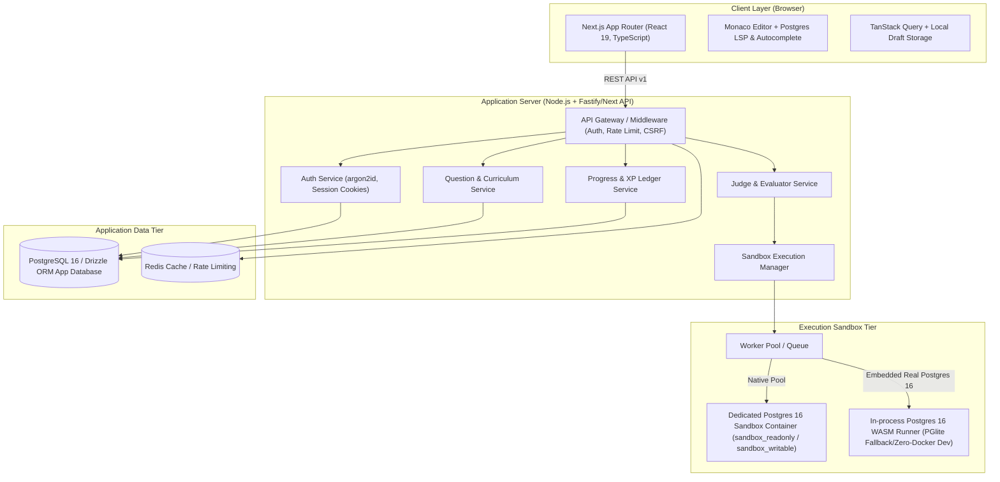

# System Design Document: SQL Practice & Learning Platform

## 1. Requirements Analysis

### 1.1 Functional Requirements
- **Curriculum & Questions:**
  - 10 structured levels from absolute beginner (SELECT, WHERE, ORDER BY) to advanced (Window Functions, CTEs, Recursive queries, PL/pgSQL, Real-world scenarios).
  - Practice question bank with at least 3 original, verified questions per topic across all 10 levels.
  - Multi-test evaluation: 1 visible test case + >=2 hidden test cases with alternate datasets (testing edge cases, NULLs, duplicate handling, ties).
  - Multi-statement DDL/DML support for views, temporary tables, indexes, triggers, and transactions with verification queries.
  - Interactive progressive hint system (3 levels, 20% XP penalty per level, floor 40%).
  - Gated solution reveals (forfeits XP, shows step-by-step breakdown and common mistakes).
- **Execution & Judging Engine:**
  - Zero mocked or fake SQL: All queries run against real PostgreSQL 16.
  - Sandbox isolation with zero access to application database, host system, or network egress.
  - Strict resource constraints (statement timeouts, memory limits, max rows: 1,000, max payload: 1MB).
  - Comprehensive error translation: PostgreSQL SQLSTATE codes mapped to friendly, actionable plain-English feedback with caret positions.
  - Normalized multiset and ordered result comparison with numeric floating-point tolerance, NULL equality, and case-insensitive column name matching.
  - Performance analysis via opt-in `EXPLAIN (ANALYZE, BUFFERS, FORMAT JSON)` on read-only sandbox queries.
- **Practice Interface:**
  - 3-panel responsive layout: Interactive schema explorer (left), Monaco code editor with PostgreSQL autocompletion and shortcuts (center), Question instructions / Results / Test Cases tabbed drawer (right/bottom).
  - Practice Mode toggle: Anti-paste restrictions within the editor as an educational typing-reinforcement tool (default off, best effort, accessible).
  - Query history drawer with pagination and instant "Reopen in Editor".
  - Autosaved query drafts per question.
- **Progression & Gamification:**
  - XP ledger system: Append-only ledger awarding base XP (Easy: 10, Medium: 25, Hard: 50, Expert: 100) on first correct solve.
  - Level calculation formula: `level = floor(sqrt(totalXP / 50)) + 1`.
  - User streak tracking aligned with profile timezone.
  - Accuracy metric, difficulty breakdowns, topic mastery tracking (>=80% solved with >=70% accuracy).
  - Explainable rules-based recommendations identifying weak topics.
  - Deterministic daily challenges with 2x XP multiplier.
  - Timed Interview Mode with role tracks, time limits, and post-session review.
  - Idempotent badge & achievement engine.
- **SQL Playground:**
  - Persistent per-user sandboxed schema with DDL/DML quotas and reset capability.
  - CSV/JSON export and multi-statement execution.

### 1.2 Non-Functional Requirements
- **Performance:** Simple query execution round-trip p95 < 500ms; multi-case submission p95 < 2000ms; full-text search < 300ms.
- **Security:** Total separation of App DB and Execution DB. Restricted DB roles, AST pre-validation, connection sanitization, parameterized queries, argon2id password hashing, httpOnly SameSite cookies.
- **Reliability:** Sandbox crashes or runaway queries isolated from backend API. Worker pool queue with graceful cancellation.
- **Accessibility:** WCAG 2.1 AA compliant, visible focus states, ARIA announcements (`aria-live`), difficulty conveyed via text + icons + badges.

---

## 2. Architecture



### 2.1 Monorepo / Project Structure
The project is organized cleanly with Next.js App Router for the unified full-stack experience (or separated Next.js frontend + Fastify backend):
```
/
├── apps/
│   └── web/                   # Next.js 15+ App Router application
│       ├── app/               # Routes: /, /login, /register, /dashboard, /topics, /practice/[slug], /playground
│       ├── components/        # UI components (Editor, SchemaViewer, ResultTable, Layout)
│       ├── lib/               # Shared utilities, API client, hooks
│       └── styles/            # Tailwind CSS styling & themes
├── packages/
│   ├── core/                  # Core domain logic, schemas, and types
│   ├── database/              # Drizzle ORM schema, migrations, and App DB client
│   └── engine/                # SQL Execution engine, parser, sandbox, result comparator
├── datasets/                  # Seed datasets (schema.sql, data.sql, alternate hidden cases)
│   ├── employeedb/
│   ├── ecommercedb/
│   ├── collegedb/
│   └── scenarios/             # Level 10 realistic databases
├── questions/                 # Question bank definitions (JSON/YAML)
├── docs/                      # DESIGN.md, DECISIONS.md, SANDBOX.md
├── docker-compose.yml         # Multi-container local infra (app-db, execution-db, redis)
└── tests/                     # Unit, integration, security, and content validation suites
```

---

## 3. Database Schema (Application Database)

Normalized relational schema managed via Drizzle ORM / Prisma with migrations:

### 3.1 Tables
1. **users**: `id (UUID PK)`, `email (unique)`, `password_hash`, `name`, `avatar_url`, `role ('user'|'admin')`, `timezone`, `onboarding_completed`, `created_at`, `updated_at`
2. **sessions**: `id (token PK)`, `user_id (FK)`, `expires_at`, `ip_address`, `user_agent`, `created_at`
3. **user_settings**: `user_id (PK, FK)`, `practice_mode_enabled (bool)`, `theme ('dark'|'light')`, `leaderboard_visible (bool)`, `keyboard_shortcuts (jsonb)`
4. **topics**: `id (text PK)`, `level (1-10)`, `title`, `slug (unique)`, `description`, `icon`, `order_index`
5. **subtopics**: `id (text PK)`, `topic_id (FK)`, `title`, `slug`, `order_index`, `summary`
6. **sql_databases**: `id (text PK)`, `name`, `description`, `category`
7. **db_tables**: `id (UUID PK)`, `database_id (FK)`, `name`, `description`
8. **db_columns**: `id (UUID PK)`, `table_id (FK)`, `name`, `data_type`, `is_pk (bool)`, `is_fk (bool)`, `fk_target_table`, `fk_target_column`, `is_nullable (bool)`
9. **questions**:
   - `id (UUID PK)`, `slug (unique)`, `title`, `description_markdown`, `topic_id (FK)`, `subtopic_id (FK)`, `difficulty ('easy'|'medium'|'hard'|'expert')`
   - `dialect ('postgresql')`, `database_id (FK)`, `question_type ('select'|'ddl_dml')`
   - `expected_columns (jsonb: array of {name, type})`, `order_matters (bool)`, `comparison_config (jsonb)`
   - `starter_query (text)`, `solution_query (text)`, `solution_explanation (text)`, `alternative_solutions (jsonb)`
   - `common_mistakes (jsonb)`, `interview_tip (text)`, `hints (jsonb: 3 levels)`, `tags (text[])`, `source (text)`
   - `estimated_minutes (int)`, `xp (int)`, `status ('draft'|'published'|'archived')`, `version (int)`
10. **question_test_cases**:
    - `id (UUID PK)`, `question_id (FK)`, `name`, `is_hidden (bool)`, `dataset_name (text)`, `setup_sql (text)`, `verification_sql (text)`
11. **user_question_state**:
    - `user_id (FK)`, `question_id (FK)`, `is_solved (bool)`, `hints_used (int: 0-3)`, `solution_viewed (bool)`, `first_solved_at (timestamp)`, `xp_awarded (int)`, `PK(user_id, question_id)`
12. **user_attempts**:
    - `id (UUID PK)`, `user_id (FK)`, `question_id (FK)`, `query_text (text)`, `verdict ('correct'|'incorrect'|'error'|'timeout')`
    - `execution_time_ms (int)`, `passed_test_cases (int)`, `total_test_cases (int)`, `error_message (text)`, `created_at`
13. **xp_events** (Append-Only Ledger):
    - `id (UUID PK)`, `user_id (FK)`, `source_type ('question_solve'|'daily_challenge'|'streak_bonus')`, `source_id (text)`, `amount (int)`, `created_at`
14. **saved_questions**: `user_id (FK)`, `question_id (FK)`, `created_at`, `PK(user_id, question_id)`
15. **query_history**: `id (UUID PK)`, `user_id (FK)`, `question_id (FK, nullable)`, `query_text (text)`, `status (text)`, `created_at`
16. **daily_challenges**: `id (UUID PK)`, `challenge_date (date unique)`, `question_id (FK)`, `bonus_multiplier (float)`
17. **daily_challenge_attempts**: `id (UUID PK)`, `challenge_id (FK)`, `user_id (FK)`, `is_solved (bool)`, `time_taken_seconds (int)`, `created_at`
18. **badges**: `id (text PK)`, `name`, `description`, `icon`, `criteria (jsonb)`
19. **user_badges**: `user_id (FK)`, `badge_id (FK)`, `unlocked_at (timestamp)`, `PK(user_id, badge_id)`

---

## 4. API Design (`/api/v1`)

All requests and responses use strict JSON and Zod validation:

### 4.1 Response Envelope
```typescript
interface ApiResponse<T> {
  success: true;
  data: T;
}

interface ApiErrorResponse {
  success: false;
  error: {
    code: string;
    message: string;
    details?: unknown;
    requestId: string;
  };
}
```

### 4.2 Endpoint Manifest
- **Auth:**
  - `POST /api/v1/auth/register` - Create user with argon2id hashed password
  - `POST /api/v1/auth/login` - Authenticate & set httpOnly session cookie
  - `POST /api/v1/auth/logout` - Clear session
  - `GET /api/v1/auth/me` - Current session & profile
- **Topics & Questions:**
  - `GET /api/v1/topics` - List curriculum topics & subtopics with user progress
  - `GET /api/v1/topics/:slug/questions` - List questions in topic with filters
  - `GET /api/v1/questions/:slug` - Fetch question details, metadata, visible schema (no hidden test data or solution)
  - `GET /api/v1/questions/:slug/schema` - Interactive table/column metadata and preview rows
- **Execution & Judging:**
  - `POST /api/v1/questions/:slug/execute` - Run query in sandbox against visible test dataset (returns results table, execution time, row count)
  - `POST /api/v1/questions/:slug/submit` - Execute against all test cases (visible + hidden), evaluate correctness, update XP & state atomically
  - `GET /api/v1/questions/:slug/hints?level=n` - Reveal hint level 1-3, record hint penalty
  - `POST /api/v1/questions/:slug/solution/reveal` - Forfeit XP and reveal full solution + explanation
- **User Progression:**
  - `GET /api/v1/user/dashboard` - Stats, streak, XP, accuracy, weekly chart, recommended practice
  - `GET /api/v1/user/history` - Paginated query history
  - `POST /api/v1/user/saved-questions/:slug` - Toggle bookmark
- **Playground:**
  - `POST /api/v1/playground/execute` - Execute script in user's isolated sandbox schema
  - `POST /api/v1/playground/reset` - Drop and re-provision user's sandbox schema
- **Daily Challenge:**
  - `GET /api/v1/daily-challenge/today` - Today's challenge metadata and status

---

## 5. SQL Execution Engine & Sandbox

Refer to `docs/SANDBOX.md` for full implementation details.
1. **Isolation Model:**
   - App DB is completely separate from execution engine.
   - Dual-runner capability: Dedicated Postgres 16 container with `sandbox_readonly` role in containerized environments; embedded WASM Postgres 16 (PGlite) in standalone host mode.
2. **Statement Validation:**
   - Multi-stage validation: AST parsing to enforce single SELECT statement allowlist for standard questions.
   - Disallowed operations: blocked system catalogs, `COPY`, file access, DDL on system schemas, procedural language creation.
3. **Resource & Safety Limits:**
   - 5s statement timeout (10s playground).
   - 1,000 maximum row limit.
   - 1MB max result payload.
   - 10,000 character maximum query size.
   - Ephemeral rollback transaction for every run.
4. **Result Comparator:**
   - Column normalization (case-insensitive name match option, exact position match).
   - Row normalization: Multiset comparison (unordered by default, ordered when `order_matters: true`).
   - Floating-point epsilon tolerance (1e-6).
   - Detailed non-leaking diagnostic feedback (wrong row count, wrong columns, wrong values).

---

## 6. Frontend Layout & User Experience

1. **Practice View (Desktop 3-Panel):**
   - **Left Panel (25% width):** Collapsible schema browser showing database tables, column data types, PK/FK indicators, and 10-row preview drawer.
   - **Center Panel (45% width):** Monaco Editor with custom dark theme, PostgreSQL keywords/functions autocompletion, status bar with format/reset buttons, and Practice Mode banner.
   - **Right Panel (30% width):** Tabs for Problem Description, Hints, Solution, Query Results, Test Case Results (Visible vs Hidden summary).
2. **Practice Mode (Anti-Paste):**
   - Editor-level event interceptor blocking `paste`, `drop`, and `Ctrl/Cmd+V` to build tactile SQL fluency.
   - Informative dismissible banner and settings toggle.
3. **Accessibility:**
   - ARIA live regions for query run status.
   - Keyboard navigation (`Ctrl+Enter` to run, `Ctrl+Shift+Enter` to submit, `Ctrl+Shift+F` to format).
   - High contrast status badges (Green check, Red cross, Yellow warning with distinct icons and text).
