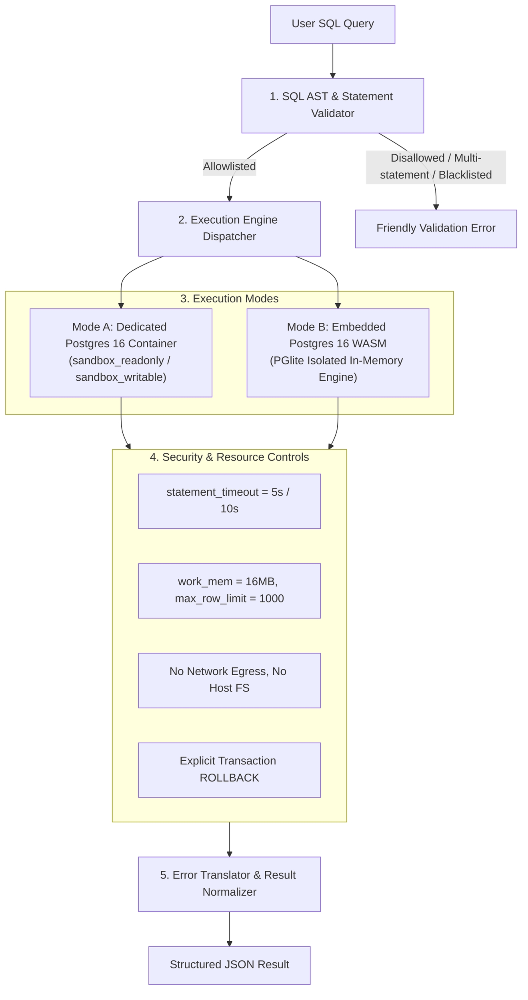
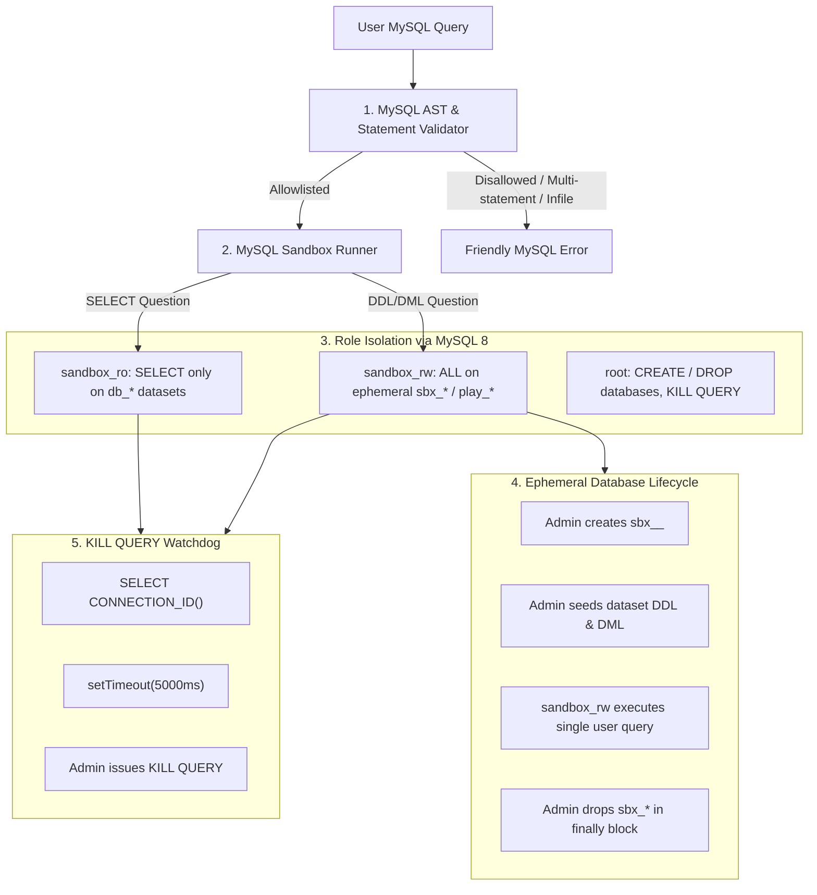

# SQL Execution Engine and Sandbox Architecture

## 1. Overview and Threat Model

The SQL sandbox is the most critical component of the platform. Its core responsibilities:
1. Execute arbitrary user SQL queries safely and deterministically against real PostgreSQL 16.
2. Ensure strict isolation between user execution environments, the application database, and the host operating system.
3. Prevent Denial-of-Service (DoS), resource starvation, data exfiltration, and privilege escalation.
4. Provide high-fidelity, beginner-friendly error diagnostics and exact performance metrics.

---

## 2. Sandbox Isolation Architecture

### 2.1 Least Privilege Roles & Schema Partitioning (Container Mode)
In production and Docker Compose environments:
- **`sandbox_readonly` Role:**
  - `USAGE` and `SELECT` granted only on dataset-specific schemas (e.g. `employeedb`, `ecommercedb`, `collegedb`).
  - `CREATE`, `INSERT`, `UPDATE`, `DELETE`, `TRUNCATE`, `ALTER`, `DROP` explicitly revoked.
  - `CREATE` privilege on `public` schema revoked.
  - No superuser privileges; `NOINHERIT`, `NOCREATEDB`, `NOCREATEROLE`.
- **`sandbox_writable` Role (DDL/DML & Playground):**
  - Allowed only within an ephemeral per-session schema or per-user playground schema (`pg_<user_id>`).
  - Quotas enforced: maximum 10 tables, maximum 5,000 rows, maximum 5MB table size.
- **Search Path Isolation:**
  - `SET LOCAL search_path TO <target_schema>;` executed at the start of each query transaction.
  - System catalogs (`pg_catalog`, `information_schema`) access restricted where possible, blocking access to `pg_shadow`, `pg_authid`, and internal connection tables.

### 2.2 Embedded Postgres 16 WASM Sandbox (Embedded Mode)
- Powered by official PostgreSQL 16 WebAssembly build (`@electric-sql/pglite`).
- Spawns completely fresh in-memory PostgreSQL 16 instances per test case or session.
- Because it runs inside the WebAssembly sandbox:
  - Zero access to host filesystem (virtual in-memory filesystem only).
  - Zero network egress capability.
  - Zero shared memory or process state with other users or application database.
  - Real PostgreSQL 16 engine: parses, plans, and executes identical Postgres SQL, generates exact Postgres error codes (`42601`, `42703`, `42P01`), and executes `EXPLAIN (ANALYZE, BUFFERS, FORMAT JSON)`.

---

## 3. Defense-in-Depth Security Controls

### 3.1 Statement & AST Validation
Before any query reaches the database:
1. **Length Check:** Query text capped at 10,000 characters.
2. **Statement Count Check:**
   - For standard `select` practice questions: strictly **one** statement allowed.
   - Rejects semicolon chaining, multiple commands, or empty strings.
3. **Keyword & AST Allowlisting:**
   - Standard questions must begin with `SELECT` or `WITH ... SELECT`.
   - Prohibited commands: `COPY`, `pg_read_file`, `pg_ls_dir`, `pg_write_file`, `ALTER SYSTEM`, `CREATE ROLE`, `DROP DATABASE`, `GRANT`, `REVOKE`, `SET SESSION AUTHORIZATION`, `LISTEN`, `NOTIFY`, `VACUUM`.
4. **Defense in Depth Principle:** Database-level role permissions and timeouts are the true security boundary; validation serves to provide instant, friendly guidance.

### 3.2 Resource Limits
- `statement_timeout`: 5,000 ms (practice questions), 10,000 ms (playground).
- `lock_timeout`: 1,000 ms.
- `idle_in_transaction_session_timeout`: 5,000 ms.
- Max Rows Returned: 1,000 rows. Queries returning more are truncated with `has_more: true` and a user notice.
- Max Payload Size: 1 MB.
- Transaction Guarantees: Every practice query runs in `BEGIN; ... ROLLBACK;` to guarantee idempotent, zero-side-effect execution.

---

## 4. Error Translation System

PostgreSQL errors and SQLSTATE codes are translated into human-friendly explanations with actionable suggestions:

| SQLSTATE | Postgres Error | User-Friendly Translation | Guidance / Suggestion |
|---|---|---|---|
| `42601` | Syntax error | "There is a syntax error in your query." | Identifies typos (e.g. `FORM` -> `FROM`, `WHER` -> `WHERE`) and displays line/column marker. |
| `42703` | Undefined column | "Column '{name}' does not exist." | Suggests closest column names from the active tables (e.g. "Did you mean `salary`?"). |
| `42P01` | Undefined table | "Table '{name}' does not exist." | Lists all available tables in this database (e.g. `employees`, `departments`). |
| `42803` | Grouping error | "Column '{name}' must appear in the GROUP BY clause or be used in an aggregate function." | Explains that non-aggregated SELECT columns require grouping. |
| `42P02` | Undefined parameter | "Parameter error in query." | Guides user on literal syntax. |
| `57014` | Query canceled | "Query execution timed out after 5.0 seconds." | Alerts user to potential infinite loops, runaway joins (Cartesian products), or missing JOIN conditions. |

Raw stack traces, internal database roles, hostnames, and IP addresses are completely stripped from user responses.

---

## 5. Result Comparison & Judge Engine

### 5.1 Submission Pipeline
1. Run user SQL against Test Case 1 (Visible Sample Dataset).
2. Run user SQL against Test Case 2 (Hidden Edge-Case Dataset 1: NULLs, edge dates, ties).
3. Run user SQL against Test Case 3 (Hidden Edge-Case Dataset 2: empty tables, boundary cases).
4. For each test case:
   - Run reference `solution_query` against the identical dataset.
   - Fetch results and normalize schemas.
   - Compare outputs.
5. If all pass: return `verdict: "correct"`, calculate XP, record attempt.
6. If any fail: return `verdict: "incorrect"`, report test cases passed (e.g., `Passed: 2/3`) and non-leaking diagnostic feedback (e.g., "Row count mismatch: expected 15 rows, your query returned 18 rows").

---

## 6. MySQL 8 Engine Sandbox Architecture (Phase 2)

### 6.1 Security Controls & Hardening
- **Port:** Dedicated isolated MySQL instance on localhost port `3307`.
- **System Flags:** `local-infile=OFF`, `skip-log-bin`, `secure-file-priv=""`, `sql_mode=ONLY_FULL_GROUP_BY,STRICT_TRANS_TABLES`.
- **Restricted Access:** Ast-level blocking of `mysql`, `performance_schema`, `sys`, `information_schema.user_privileges`.
- **Prohibited Functions:** File manipulation (`LOAD DATA`, `INTO OUTFILE`, `LOAD_FILE`), Denial of Service (`BENCHMARK`), admin control (`SHUTDOWN`, `GRANT`, `SET GLOBAL`).
- **Query Timeout:** Dual-level enforcement:
  1. Application-level timer tracks query duration.
  2. Dedicated admin connection issues `KILL QUERY <threadId>` if timeout threshold (5s/10s) is exceeded.
- **Result Normalization:** Numbers, BigInts, Decimals, dates, and JSON strings are normalized to match standard JavaScript JSON representation for deterministic evaluation.

